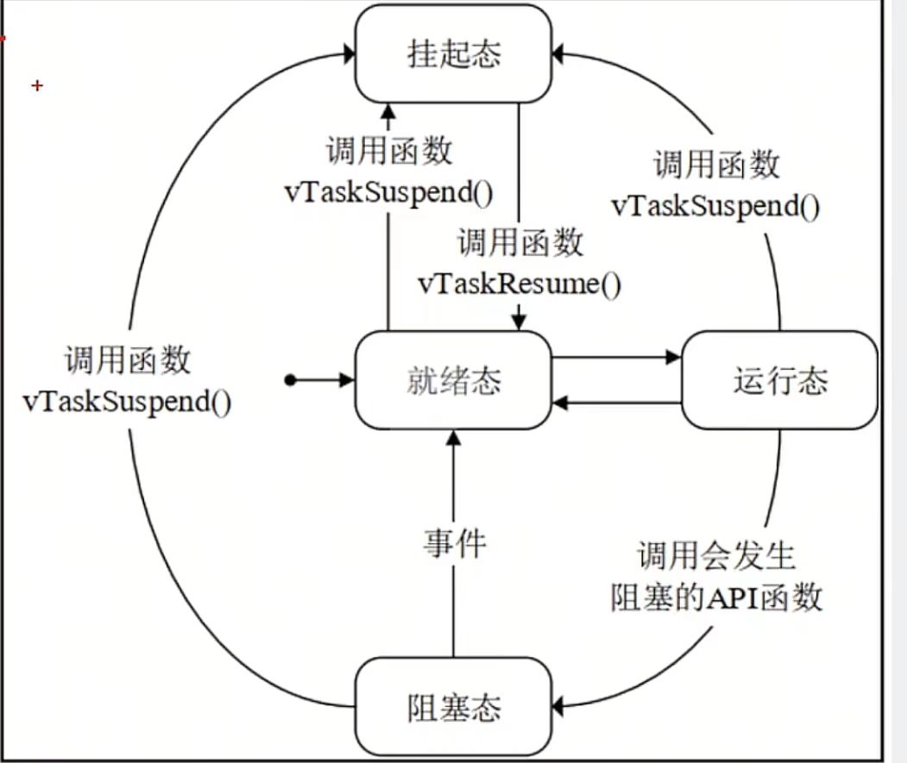

## 八、无线通信与系统

### 8.1 WiFi 与网络通信

**常用 API 与调用流程**

| 步骤 | 调用 | 作用 |
| --- | --- | --- |
| 1 初始化网络栈 | `esp_netif_init()` + `esp_event_loop_create_default()` | 建网络接口和事件循环，只做一次 |
| 2 建网卡 | `esp_netif_create_default_wifi_ap()` / `..._sta()` | 按模式建对应的网卡 |
| 3 初始化 WiFi | `esp_wifi_init(&cfg)` | 传入默认配置 |
| 4 注册事件 | `esp_event_handler_instance_register(WIFI_EVENT, ...)` | 连上、断开时要做什么 |
| 5 设模式 | `esp_wifi_set_mode(WIFI_MODE_AP)` / `WIFI_MODE_STA` | 自己当热点，还是去连路由器 |
| 6 配参数 | `esp_wifi_set_config(WIFI_IF_AP / WIFI_IF_STA, &cfg)` | 热点名密码 / 目标路由器账号 |
| 7 启动 | `esp_wifi_start()` | 启动；STA 模式启动后会自动去连 |
| 8 断线重连 | 事件里收到 `WIFI_EVENT_STA_DISCONNECTED` 就调 `esp_wifi_connect()` | 掉线自动重连 |

> 第 1 ~ 3 步是固定的"起手式"，AP 和 STA 完全一样，从第 4 步起两条路才分开。**别把 `esp_wifi_start()` 当成"已经连上了"** —— 它只是把 WiFi 打开，连上的结果会以事件的形式回调过来。

---
#### 8.1.1 AP 模式（设备作为热点）

**原理**：AP 模式下 ESP32-S3 自身产生热点，手机或电脑连接后可与其直接通信，常用于设备配网与局域网控制。

> 完整代码见 [第 4 册 · 小车实验六](04-小车开发板实验.html#实验六-esp32-wifi-ap-模式实验)、[第 5 册 · 无人机实验一（WiFi AP 模式）](05-无人机开发板实验.html#实验一-esp32-wifi-ap-模式实验)

#### 8.1.2 STA 模式（连接路由器）

> 完整代码见 [第 4 册 · 小车实验七（WiFi STA 模式）](04-小车开发板实验.html#实验七-esp32-wifi-sta-模式实验)

STA 是 Station（站点）的缩写，指设备像手机一样**作为客户端去连别人的路由器**；相对的 AP 模式是设备自己当热点。

**注意事项**：ESP32 系列只支持 2.4GHz 频段；连接失败会周期性重试，需在事件回调中处理 `WIFI_EVENT_STA_DISCONNECTED` 并调用 `esp_wifi_connect()` 重新连接。

#### 8.1.3 UDP 通信

**原理**：UDP 无连接、开销小，适合周期性数据上报。使用标准 BSD Socket 接口。

> **端口**是同一台设备上用来区分不同程序的编号（0~65535）。比如设备同时跑了一个网页服务和一个数据上报，就是靠端口号把两路数据分开的。

> 完整代码见 [第 4 册 · 小车实验六（WiFi AP 模式，含 UDP 服务器）](04-小车开发板实验.html#实验六-esp32-wifi-ap-模式实验)
**调用流程**（标准 Socket 接口）

| 步骤 | 调用 | 作用 |
| --- | --- | --- |
| 1 建套接字 | `socket(AF_INET, SOCK_DGRAM, 0)` | 拿回套接字描述符（一个整数，代表这条通信通道） |
| 2 绑端口 | `bind(fd, &addr, sizeof(addr))` | 服务器必须绑；客户端可以不绑，由系统分配 |
| 3 收发 | `recvfrom()` / `sendto()` | 每次收发都要带对方地址，因为没有连接 |
| 4 关闭 | `close(fd)` | 用完关掉 |

> UDP 没有连接，所以 `sendto()` 每次都得写明"发给谁"，`recvfrom()` 也会告诉你"是谁发来的"。

#### 8.1.4 TCP 通信

TCP 面向连接，适合对可靠性要求高的场景。**"面向连接"的意思是**：正式传数据之前，双方要先确认彼此都在、都准备好了，这个确认过程叫**三次握手**（我问你在吗 → 你回答在 → 我确认收到）—— 之后才开始传数据。

**为什么要这么麻烦**：因为 TCP 保证"发出去的数据一定会按顺序到达"，代价就是建连接慢一点、开销大一点。所以**要求可靠用 TCP，要求快用 UDP**。服务器流程为 `socket → bind → listen → accept → recv/send`，客户端流程为 `socket → connect → send/recv`。

> 完整代码见 [第 4 册 · 小车实验六（WiFi AP 模式，含 TCP 服务器）](04-小车开发板实验.html#实验六-esp32-wifi-ap-模式实验)
**调用流程**（标准 Socket 接口）

服务器：

| 步骤 | 调用 | 作用 |
| --- | --- | --- |
| 1 | `socket(AF_INET, SOCK_STREAM, 0)` | 建套接字 |
| 2 | `bind()` | 绑定自己的 IP 与端口 |
| 3 | `listen()` | 开始监听，并指定同时能排队几个客户端 |
| 4 | `accept()` | 阻塞等待客户端连进来，返回一个**新的**套接字代表这条连接 |
| 5 | `recv()` / `send()` | 在这条连接上收发 |
| 6 | `close()` | 关闭连接 |

客户端：

| 步骤 | 调用 | 作用 |
| --- | --- | --- |
| 1 | `socket(AF_INET, SOCK_STREAM, 0)` | 建套接字 |
| 2 | `connect()` | 主动去连服务器（三次握手就发生在这里） |
| 3 | `send()` / `recv()` | 收发 |
| 4 | `close()` | 关闭 |

> 一个容易看错的地方：`accept()` 返回的是**新套接字**，代表"和这个客户端的这条连接"；原来那个套接字继续留着，用来接下一个客户端。

#### 8.1.5 HTTP 服务器

**原理**：`esp_http_server` 提供 HTTP 服务，通过注册 **URI** 处理函数响应浏览器请求，可用于数据展示页面与 MJPEG 视频流。

> **URI** 就是网址里域名后面的那一段路径，比如 `http://192.168.1.100/hello` 里的 `/hello`。注册一个 URI，就是告诉设备"浏览器访问这个路径时该执行哪个函数"。

```c
#include "freertos/FreeRTOS.h"
#include "freertos/task.h"
#include "esp_log.h"

#include "esp_http_server.h"

static esp_err_t hello_handler(httpd_req_t *req)
{
    const char *html = "<h1>ESP32-S3 Server</h1><p>Hello</p>";
    httpd_resp_set_type(req, "text/html");
    httpd_resp_send(req, html, HTTPD_RESP_USE_STRLEN);
    return ESP_OK;
}

void http_server_start(void)
{
    httpd_config_t cfg = HTTPD_DEFAULT_CONFIG();
    httpd_handle_t server = NULL;
    httpd_start(&server, &cfg);

    httpd_uri_t uri = {
        .uri     = "/hello",
        .method  = HTTP_GET,
        .handler = hello_handler,
    };
    httpd_register_uri_handler(server, &uri);
}

void app_main(void)
{
    http_server_start();
    ESP_LOGI("http", "web server started");

    while (1)
    {
        vTaskDelay(pdMS_TO_TICKS(1000));
    }
}
```

**常用 API 与调用流程**

| 步骤 | 调用 | 作用 |
| --- | --- | --- |
| 1 启动服务 | `httpd_start(&server, &cfg)` | 建 HTTP 服务器，拿回句柄（`HTTPD_DEFAULT_CONFIG()` 给默认配置） |
| 2 注册路径 | `httpd_register_uri_handler(server, &uri)` | 把某个网址路径绑到一个处理函数上 |
| 3 处理请求 | 回调里 `httpd_resp_set_type()` + `httpd_resp_send()` | 设返回类型、把内容发回浏览器 |
| 4 停止服务 | `httpd_stop(server)` | 不用时关掉 |

> 一个 URI 对应一个处理函数，想加页面就再注册一条。返回内容前记得先 `httpd_resp_set_type()` 设好类型，否则浏览器可能当成纯文本显示。
**说明**：`handler` 参数接收的是一个**函数指针**。`hello_handler` 不是被主程序直接调用的，而是由 HTTP 服务器在收到对应 URI 请求时回调执行 —— 这种机制称为**回调**。

---

### 8.2 BLE 低功耗蓝牙

#### 原理

BLE 协议栈分成两层理解：**GAP 管"怎么连上"，GATT 管"连上之后传什么"**。

- **GAP**：负责广播（让别人发现自己）、发起/接受连接、连接参数；
- **GATT**：负责数据怎么组织 —— 用**服务**和**特征值**打包数据。

应用层使用 GATT 模型组织数据：服务（Service）包含若干特征值（Characteristic），每个特征值拥有唯一的 UUID。手机与设备的交互方式是：手机写入特征值（Write）下发指令，设备通过通知（Notify）上传数据。

#### 初始化骨架

> 完整代码见 [第 4 册 · 小车实验八（ESP32 蓝牙模块实验）](04-小车开发板实验.html#实验八-esp32-蓝牙模块实验)
**常用 API 与调用流程**（NimBLE）

| 步骤 | 调用 | 作用 |
| --- | --- | --- |
| 1 初始化协议栈 | `nimble_port_init()` | 蓝牙协议栈的起手式，只做一次 |
| 2 初始化标准服务 | `ble_svc_gap_init()` + `ble_svc_gatt_init()` | 把 GAP / GATT 这两个必备服务建起来 |
| 3 注册自定义服务 | `ble_gatts_count_cfg(gatt_svcs)` + `ble_gatts_add_svcs(gatt_svcs)` | 先数一遍再添加，把服务与特征值注册进去 |
| 4 设设备名 | `ble_svc_gap_device_name_set("名字")` | 手机扫描时看到的名字 |
| 5 挂回调 | `ble_hs_cfg.sync_cb` / `ble_hs_cfg.reset_cb` | 协议栈就绪、异常复位时做什么 |
| 6 启动主机任务 | `nimble_port_freertos_init(host_task)` | 起一个后台任务跑协议栈（任务里调 `nimble_port_run()`） |
| 7 开始广播 | `sync_cb` 里 `ble_gap_adv_set_fields()` + `ble_gap_adv_start()` | 广播出去，等手机来连 |
| 8 处理事件 | `ble_gap_event()` 回调 | 处理连接、断开、订阅 |

> 记住一点：**第 6 步之后，蓝牙自己在一个独立任务里跑**，`app_main` 里看不到"接收数据"的循环 —— 数据是通过回调送进来的。


#### 数据发送

> 手机要读写数据，需要完整的 GATT 服务。本课程直接使用[第 4 册「小车实验八」](04-小车开发板实验.html#实验八-esp32-蓝牙模块实验)的工程代码，NimBLE 是 ESP-IDF 内置的轻量蓝牙协议栈（比另一套 Bluedroid 更省内存）。它用 NimBLE 搭好了服务与特征值，手机连上后写入的数据会打印到串口。

#### 典型事件流程

| 阶段 | 触发点 | 处理内容 |
| --- | --- | --- |
| 协议栈就绪 | `ble_hs_cfg.sync_cb` | 设置广播内容，开始广播 |
| 开始广播 | `ble_gap_adv_start()` | 等待手机连接 |
| 连接建立 | `ble_gap_event()` 收到 `BLE_GAP_EVENT_CONNECT` | 记录连接句柄、停止广播 |
| 手机写入特征值 | 特征值的访问回调（`ble_gatt_access_ctxt`） | 解析手机下发的内容 |
| 连接断开 | `ble_gap_event()` 收到 `BLE_GAP_EVENT_DISCONNECT` | 重新开始广播 |
| 异常复位 | `ble_hs_cfg.reset_cb` | 记录日志、准备重来 |

**调试工具**：手机安装 `nRF Connect`，扫描到设备后连接，可查看服务与特征值并手动读写数据。

---


### 8.3 MQTT 与多协议网关

#### 1. MQTT 基本概念

MQTT 是基于发布／订阅模型的轻量级消息协议，适合设备与云平台之间的数据传输。

| 概念 | 含义 |
| --- | --- |
| Broker | 消息代理服务器，负责转发所有消息（如 EMQX、Mosquitto） |
| Topic | 话题，用 `/` 分层（如 `classroom/room1/temperature`），发布与订阅按话题匹配 |
| Publish / Subscribe | 设备发布数据到话题；订阅该话题的客户端即可收到 |
| QoS | 服务质量等级：0 最多一次、1 至少一次、2 恰好一次 |
| Retain | 保留消息，新订阅者立即收到该话题的最后一条消息 |
| LWT | 遗嘱消息，设备异常断开时由 Broker 代为发布，用于掉线告警 |

与 HTTP 的对比：HTTP 是请求—响应模式，由客户端主动发起；MQTT 建立一条长连接后，服务器可主动向设备推送消息，更适合高频上报与远程下发。

#### 2. 官方 esp-mqtt 用法

```c
#include "mqtt_client.h"
#include "esp_log.h"

static const char *TAG = "mqtt";
static esp_mqtt_client_handle_t s_client = NULL;

/* 客户端事件回调 */
static void mqtt_event_handler(void *args, esp_event_base_t base,
                               int32_t event_id, void *event_data)
{
    esp_mqtt_event_handle_t event = event_data;

    switch ((esp_mqtt_event_id_t)event_id)
    {
    case MQTT_EVENT_CONNECTED:
        ESP_LOGI(TAG, "connected to broker");
        esp_mqtt_client_subscribe(s_client, "classroom/cmd", 1);   /* 订阅控制话题 */
        break;

    case MQTT_EVENT_DATA:
        ESP_LOGI(TAG, "topic: %.*s, data: %.*s",
                 event->topic_len, event->topic,
                 event->data_len, event->data);
        break;

    case MQTT_EVENT_DISCONNECTED:
        ESP_LOGW(TAG, "disconnected from broker");
        break;

    default:
        break;
    }
}

void mqtt_start(const char *broker_uri)
{
    esp_mqtt_client_config_t cfg = {
        .broker.address.uri = broker_uri,      /* 例如 "mqtt://192.168.1.100:1883" */
    };

    s_client = esp_mqtt_client_init(&cfg);
    esp_mqtt_client_register_event(s_client, ESP_EVENT_ANY_ID, mqtt_event_handler, NULL);
    esp_mqtt_client_start(s_client);
}

/* 上报数据：topic 为话题，payload 为内容 */
void mqtt_report(const char *topic, const char *payload)
{
    esp_mqtt_client_publish(s_client, topic, payload, 0, 1, 0);
}

void app_main(void)
{
    /* 先连上 WiFi，再启动 MQTT 客户端 */
    mqtt_start("mqtt://192.168.1.100:1883");

    while (1)
    {
        mqtt_report("classroom/temperature", "25");
        vTaskDelay(pdMS_TO_TICKS(5000));
    }
}
```

**常用 API 与调用流程**

| 步骤 | 调用 | 作用 |
| --- | --- | --- |
| 1 配参数 | `esp_mqtt_client_config_t` 里填 `broker.address.uri` | 指定 Broker 地址，例如 `mqtt://192.168.1.100:1883` |
| 2 建客户端 | `esp_mqtt_client_init(&cfg)` | 拿回客户端句柄 |
| 3 挂事件回调 | `esp_mqtt_client_register_event()` | 连上、收到数据、掉线时做什么 |
| 4 启动 | `esp_mqtt_client_start()` | 开始连接 Broker，之后由它自己负责重连 |
| 5 订阅 | 连上后（`MQTT_EVENT_CONNECTED`）`esp_mqtt_client_subscribe()` | 订阅要接收的话题 |
| 6 上报 | `esp_mqtt_client_publish()` | 把数据发到某个话题 |
| 7 收数据 | 事件里 `MQTT_EVENT_DATA` | 解析下发内容 |

> 第 1 ~ 4 步是一次性的，之后"收"和"发"分成两条路：**收**只能等回调把数据送进来，**发**随时可以调 `esp_mqtt_client_publish()`。
**使用要点**：

- MQTT 建立在 TCP 之上，**必须先完成 WiFi 连接**再启动客户端；
- 同一时间不要用相同的 Client ID 连接两次，否则会互相踢下线；
- QoS 越高开销越大，普通数据上报使用 QoS 1 即可；
- 断线重连由 `esp-mqtt` 自动处理，可在 `MQTT_EVENT_DISCONNECTED` 中记录日志。

#### 3. 多协议网关

**网关**是嵌入式系统的典型综合形态：向下连接多种总线与传感器，向上连接网络与云平台，同时具备本地显示与本地存储能力。

**典型数据流**：

```
传感器 ──→ 总线（I2C/SPI/UART）──→ 驱动层解析 ──→ 数据队列
                                                    │
                            ┌───────────────────────┼───────────────────────┐
                            ↓                       ↓                       ↓
                      本地上报任务            云端上报任务            本地存储任务
                    （OLED 显示）        （MQTT / HTTP / TCP）    （Flash / SD 卡）
```

**网关的四个组成部分**：

| 部分 | 职责 | 用到的技术 |
| --- | --- | --- |
| 采集 | 读取各类传感器 | GPIO / ADC / I2C / SPI / UART |
| 处理 | 单位换算、滤波、协议解析、异常判断 | 数据类型、滤波算法、状态机 |
| 上报 | 数据发送到上位机或云平台 | WiFi / TCP / UDP / HTTP / MQTT |
| 配置 | 现场更换网络参数、显示运行状态 | AP 配网 / NVS / OLED |

**架构要求**：

- 采集、处理、上报分成独立任务，通过队列传递数据，避免相互阻塞；
- 共享资源（I2C 总线、串口）必须用互斥锁保护；
- 网络断开时数据先落地（NVS / SD 卡），网络恢复后补传；
- 上报任务需要周期性心跳，便于上位机判断设备是否在线。

---

### 8.4 FreeRTOS 多任务系统

#### 1. 什么是 RTOS

**RTOS（Real-Time Operating System，实时操作系统）** 是运行在单片机上的小型操作系统，它把程序拆成多个可以"同时"运行的**任务**，并负责决定"下一时刻该让哪个任务用 CPU"。

**裸机程序（不用 RTOS）和 RTOS 程序的差别**

| 对比项 | 裸机（一个 while 大循环） | RTOS |
| --- | --- | --- |
| 程序结构 | 所有功能写在一个循环里，按顺序执行 | 每个功能一个任务，各自独立循环 |
| 一个功能卡住 | 整个程序都卡住 | 只影响它自己，其他任务照常运行 |
| 定时精度 | 靠延时凑，容易越凑越偏 | 由系统统一调度，周期稳定 |
| 代码维护 | 功能一多就变成"面条代码" | 任务之间解耦，加功能不影响别人 |
| 适合场合 | 功能少、逻辑简单 | 功能多、要同时处理多个事件 |

#### 2. 多任务处理

- **定义**：让多个任务看起来在"同时"执行。
- **原理**：单核芯片其实同一时刻只能执行一个任务。RTOS 让每个任务只运行很短的一段时间，时间一到就切换到下一个，因为切换极快，看起来就像同时进行。
- **并发与并行**：单核上做到的是**并发**（轮流用 CPU），不是**并行**（真正同时）。ESP32-S3 是双核，两个任务可以真正并行。

**多任务的意义 —— 提高资源利用率**

把一个长任务拆开之后，某个任务在等延时、等数据的时候，CPU 不会被白白浪费，而是立刻去执行其他任务。这既提高了 CPU 利用率，也让每个功能都能及时响应。

#### 3. 调度器与调度策略

**调度器**是 RTOS 的核心，它负责记录每个任务的状态、决定下一步运行哪个任务、以及在任务之间做切换。

两种最基本的调度策略：

| 策略 | 做法 | 特点 |
| --- | --- | --- |
| **时间片轮询** | 给每个任务分配一段固定的时间片，轮流执行 | 每个任务都有机会运行，但紧急任务无法优先 |
| **优先级调度（抢占）** | 给每个任务分配优先级，高优先级的先执行 | 紧急任务能及时响应，但低优先级任务可能被饿死 |

#### 4. FreeRTOS 的调度策略

**FreeRTOS 的选择：抢占式优先级 + 同优先级时间片轮询**

- **优先级不同时**：高优先级任务优先执行，并且可以**打断**正在运行的低优先级任务（称为"抢占"），保证高优先级任务及时响应；
- **优先级相同时**：这些任务按时间片轮流执行，机会均等。

**FreeRTOS 的目标**

确保某些事情**在规定的时间内**被响应 —— 也就是处理外部事件的任务，能在规定时间内执行完。这就是"实时"两个字的含义：不是"快"，而是"可预期"。

#### 5. 任务状态与状态转换

FreeRTOS 中每个任务在任何时刻都处于四种状态之一：

| 状态 | 英文 | 含义 | 是否占用 CPU |
| --- | --- | --- | --- |
| **运行** | Running | 正在使用 CPU 执行 | 是 |
| **就绪** | Ready | 条件都满足，排队等着被调度 | 否 |
| **阻塞** | Blocked | 在等某个事件（延时到点、等队列、等信号量） | 否 |
| **挂起** | Suspended | 被主动暂停，不参与调度，直到被恢复 | 否 |

**同一时刻只有一个任务处于运行状态**（双核是两个），其余任务分布在就绪、阻塞、挂起三种状态里。

**状态转换关系**



**四种转换分别由谁触发**

| 从 → 到 | 触发原因 |
| --- | --- |
| 就绪 → 运行 | 调度器选中了它（没有更高优先级任务在跑） |
| 运行 → 就绪 | 时间片用完，或被更高优先级任务抢占 |
| 运行 → 阻塞 | 自己调用了 `vTaskDelay()`、`xQueueReceive()` 等"等待"类函数 |
| 阻塞 → 就绪 | 等待的事件发生了（延时到点、队列收到数据、拿到信号量） |
| 任意 → 挂起 | 被 `vTaskSuspend()` 暂停 |
| 挂起 → 就绪 | 被 `vTaskResume()` 恢复 |

#### 6. 任务队列

调度器内部用几个队列（列表）来管理任务，任务在不同状态下会被挂到不同的队列：

| 队列 | 放哪些任务 | 说明 |
| --- | --- | --- |
| **就绪队列** | 所有可以立即运行的任务 | 调度器每次从这里挑优先级最高的 |
| **阻塞队列** | 正在等待事件的任务 | 按"还要等多久"排序，等延时到点后自动回到就绪队列 |
| **挂起队列** | 被主动暂停的任务 | 除非被恢复，否则永远不参与调度 |

**理解要点**：任务调用 `vTaskDelay(500)` 之后，并不是"原地转圈等 500ms"，而是**被移出就绪队列、挂到阻塞队列**，CPU 立刻让给别人；500ms 后由系统把它放回就绪队列。这就是 RTOS 提高 CPU 利用率的关键。

#### 7. 任务切换时机与上下文切换

**什么时候会发生任务切换**

1. 当前任务主动"阻塞"（调用 `vTaskDelay`、`xQueueReceive` 等）；
2. 当前任务的时间片用完；
3. 有更高优先级的任务进入就绪（例如中断唤醒了它、队列收到了数据）；
4. 当前任务主动调用 `taskYIELD()` 让出 CPU。

**上下文切换做了什么**

任务切换时，系统要保存当前任务的"现场"，再恢复下一个任务的"现场"，这个动作叫**上下文切换**。现场主要包括：

- CPU 寄存器（程序计数器、状态寄存器、通用寄存器）
- **任务的栈**（局部变量、函数调用的返回地址都存在任务自己的栈里）

**因此有三条实际结论**

1. **每个任务必须有自己的栈**，所以 `xTaskCreate` 要指定栈大小；
2. **切换有开销**，任务不是越多越好，一般 5 ~ 10 个足够；
3. **栈太小会崩溃**，表现为重启或打印乱码 —— 用 `uxTaskGetStackHighWaterMark()` 检查余量。

#### 8. 创建任务

| 参数位置 | 含义 | 建议 |
| --- | --- | --- |
| 1 | 任务函数名 | 必须是 `void 函数名(void *参数)` 形式 |
| 2 | 任务名称 | 调试时用，简短明了 |
| 3 | 栈大小 | 单位是**字**（1 字 = 4 字节），常用 4096 |
| 4 | 传入参数 | 不用就填 `NULL` |
| 5 | 优先级 | 数字越大越优先，普通任务常用 5 |
| 6 | 任务句柄 | 不需要外部控制就填 `NULL` |

```c
#include "freertos/FreeRTOS.h"
#include "freertos/task.h"
#include "driver/gpio.h"
#include "esp_log.h"

#define LED_GPIO   GPIO_NUM_2

void task_blink(void *param)
{
    gpio_set_direction(LED_GPIO, GPIO_MODE_OUTPUT);

    while (1)
    {
        gpio_set_level(LED_GPIO, 1);
        vTaskDelay(pdMS_TO_TICKS(500));
        gpio_set_level(LED_GPIO, 0);
        vTaskDelay(pdMS_TO_TICKS(500));
    }
}

void task_report(void *param)
{
    while (1)
    {
        ESP_LOGI("task", "system running");
        vTaskDelay(pdMS_TO_TICKS(1000));
    }
}

void app_main(void)
{
    xTaskCreate(task_blink,  "blink",  4096, NULL, 5, NULL);
    xTaskCreate(task_report, "report", 4096, NULL, 5, NULL);

    while (1)
    {
        vTaskDelay(pdMS_TO_TICKS(1000));
    }
}
```

#### 9. 删除任务

任务可以删除别人，也可以删除自己：

```c
/* 删除自己：最常见，任务干完活就退出 */
vTaskDelete(NULL);

/* 删除别的任务：需要先拿到对方的任务句柄 */
TaskHandle_t handle = NULL;
xTaskCreate(task_led, "led", 4096, NULL, 5, &handle);   /* 第 6 个参数取出句柄 */
vTaskDelete(handle);                                    /* 删除它 */
```

**必须知道的两点**

- 任务删除后，它占用的**栈和任务控制块不会立即释放**，而是由空闲任务（Idle Task）负责回收。所以删除任务后不要立刻把栈上的数据拿去用；
- **不要在任务正在使用某个资源（如已经拿到互斥锁）时把它删掉**，否则锁永远无法释放，其他任务会一直等下去。

#### 10. 任务挂起与恢复

**挂起**是"主动暂停"，和"阻塞"的区别在于：

| 对比 | 阻塞（Blocked） | 挂起（Suspended） |
| --- | --- | --- |
| 谁触发的 | 任务自己调用等待类函数 | 被自己或别人调用 `vTaskSuspend()` |
| 什么时候恢复 | 等待的事件到了就自动恢复 | 必须有人调用 `vTaskResume()`，否则永远不恢复 |
| 典型用途 | 等延时、等数据 | 临时停掉某个功能（如暂停采集、暂停上报） |

```c
TaskHandle_t handle = NULL;

xTaskCreate(task_sensor, "sensor", 4096, NULL, 5, &handle);

vTaskSuspend(handle);        /* 暂停采集任务 */

/* ……做点别的…… */

vTaskResume(handle);         /* 恢复采集任务 */
```

**在中断里恢复任务**要用专门的版本：

```c
vTaskResumeFromISR(handle);  /* 中断中只能用这个版本 */
```

**注意**：`vTaskSuspend(NULL)` 表示挂起自己；被挂起的任务不会占用 CPU，也不会自动醒来。

#### 11. 任务间通信

多个任务同时运行时，如果需要交换数据或共用外设，必须用系统提供的机制，不能直接读写同一个变量。

**队列**：任务之间传数据最常用的方式，一个任务放、另一个任务取。

```c
#include "freertos/FreeRTOS.h"
#include "freertos/task.h"
#include "freertos/queue.h"
#include "esp_log.h"
static QueueHandle_t s_queue;

void producer_task(void *param)
{
    int value = 0;
    while (1)
    {
        value++;
        xQueueSend(s_queue, &value, portMAX_DELAY);   // 生产数据
        vTaskDelay(pdMS_TO_TICKS(1000));
    }
}

void consumer_task(void *param)
{
    int value = 0;
    while (1)
    {
        if (xQueueReceive(s_queue, &value, portMAX_DELAY) == pdTRUE)
        {
            ESP_LOGI("consumer", "received %d", value);   // 消费数据
        }
    }
}

void app_main(void)
{
    s_queue = xQueueCreate(10, sizeof(int));          // 队列长度 10，元素为 int
    xTaskCreate(producer_task, "producer", 4096, NULL, 5, NULL);
    xTaskCreate(consumer_task, "consumer", 4096, NULL, 5, NULL);
}
```

**互斥锁**：保护共享资源。多个任务要抢同一个 I2C 总线、同一个串口时，必须加锁。

```c
#include "freertos/FreeRTOS.h"
#include "freertos/task.h"
#include "freertos/semphr.h"
#include "esp_log.h"

static const char *TAG = "mutex";
static SemaphoreHandle_t s_mutex;
static int s_shared_count = 0;          /* 模拟共享资源（实际项目中是 I2C 总线、串口等） */

void task_a(void *param)
{
    while (1)
    {
        if (xSemaphoreTake(s_mutex, portMAX_DELAY) == pdTRUE)
        {
            s_shared_count = s_shared_count + 1;      /* 独占访问共享资源 */
            ESP_LOGI(TAG, "task A: count = %d", s_shared_count);
            xSemaphoreGive(s_mutex);                  /* 用完必须释放 */
        }
        vTaskDelay(pdMS_TO_TICKS(1000));
    }
}

void task_b(void *param)
{
    while (1)
    {
        if (xSemaphoreTake(s_mutex, portMAX_DELAY) == pdTRUE)
        {
            s_shared_count = s_shared_count + 10;
            ESP_LOGI(TAG, "task B: count = %d", s_shared_count);
            xSemaphoreGive(s_mutex);
        }
        vTaskDelay(pdMS_TO_TICKS(1500));
    }
}

void app_main(void)
{
    s_mutex = xSemaphoreCreateMutex();          /* 创建互斥锁 */

    xTaskCreate(task_a, "task_a", 4096, NULL, 5, NULL);
    xTaskCreate(task_b, "task_b", 4096, NULL, 5, NULL);
}
```

**事件组**：等待多个条件同时满足。例如"WiFi 连上了、传感器也准备好了，才开始上报"。

```c
#include "freertos/FreeRTOS.h"
#include "freertos/task.h"
#include "freertos/event_groups.h"
#include "esp_log.h"

static EventGroupHandle_t s_events;

#define BIT_WIFI_READY   (1 << 0)
#define BIT_SENSOR_READY (1 << 1)

void upload_task(void *param)
{
    EventBits_t bits = xEventGroupWaitBits(s_events,
                                           BIT_WIFI_READY | BIT_SENSOR_READY,
                                           pdFALSE, pdTRUE, portMAX_DELAY);
    if ((bits & (BIT_WIFI_READY | BIT_SENSOR_READY)) ==
        (BIT_WIFI_READY | BIT_SENSOR_READY))
    {
        ESP_LOGI("upload", "all conditions met, start uploading");
    }
}

void app_main(void)
{
    s_events = xEventGroupCreate();

    xTaskCreate(upload_task, "upload", 4096, NULL, 5, NULL);

    /* 模拟两个条件先后满足 */
    vTaskDelay(pdMS_TO_TICKS(1000));
    ESP_LOGI("main", "sensor ready");
    xEventGroupSetBits(s_events, BIT_SENSOR_READY);

    vTaskDelay(pdMS_TO_TICKS(1000));
    ESP_LOGI("main", "wifi ready");
    xEventGroupSetBits(s_events, BIT_WIFI_READY);

    while (1)
    {
        vTaskDelay(pdMS_TO_TICKS(1000));
    }
}
```

#### 12. 中断配合规范

- 中断服务函数要**尽量短**，只做"记下发生了什么"，不要在里面做耗时处理；
- 中断里调用 FreeRTOS 接口，必须使用 `...FromISR` 版本，例如 `xQueueSendFromISR()`；
- 中断里**禁止调用阻塞类接口**（`vTaskDelay()`、`xQueueReceive()`）；
- 标准做法：中断里往队列发一个事件，由任务在后面慢慢处理。

**完整写法：中断 → 队列 → 任务**

以"按键按下产生中断"为例：

```c
#include "freertos/FreeRTOS.h"
#include "freertos/task.h"
#include "freertos/queue.h"
#include "driver/gpio.h"
#include "esp_attr.h"
#include "esp_log.h"

#define KEY_GPIO   GPIO_NUM_4

static const char *TAG = "irq";
static QueueHandle_t s_queue;

/* 中断服务函数：只做一件事 —— 往队列发一个"按键事件" */
static void IRAM_ATTR key_isr(void *arg)
{
    BaseType_t woken = pdFALSE;
    int evt = 1;

    xQueueSendFromISR(s_queue, &evt, &woken);   /* 不阻塞，发完就走 */
    if (woken == pdTRUE)
    {
        portYIELD_FROM_ISR();                   /* 唤醒了更高优先级任务，立刻切换 */
    }
}

/* 处理任务：慢慢做真正的活儿 */
static void key_task(void *arg)
{
    int evt = 0;

    while (1)
    {
        if (xQueueReceive(s_queue, &evt, portMAX_DELAY) == pdTRUE)
        {
            ESP_LOGI(TAG, "key pressed");       /* 耗时处理放在这里 */
        }
    }
}

void app_main(void)
{
    s_queue = xQueueCreate(10, sizeof(int));

    gpio_config_t cfg = {
        .pin_bit_mask = 1ULL << KEY_GPIO,
        .mode         = GPIO_MODE_INPUT,
        .pull_up_en   = GPIO_PULLUP_ENABLE,
        .pull_down_en = GPIO_PULLDOWN_DISABLE,
        .intr_type    = GPIO_INTR_NEGEDGE,      /* 下降沿触发 */
    };
    gpio_config(&cfg);

    gpio_install_isr_service(0);
    gpio_isr_handler_add(KEY_GPIO, key_isr, NULL);

    xTaskCreate(key_task, "key", 4096, NULL, 5, NULL);
}
```

**为什么必须这么写**

| 写法 | 后果 |
| --- | --- |
| 中断里直接 `vTaskDelay()` | 阻塞整个系统，看门狗复位 |
| 中断里直接 `xQueueSend()`（非 ISR 版） | 断言失败，程序崩溃 |
| 中断里做打印、读传感器 | 中断时间过长，其他中断来不及响应 |
| **中断里发队列 + 任务里处理** | 中断极短，事件不丢 |

**`portYIELD_FROM_ISR()` 的作用**：如果刚才发的事件唤醒了比当前任务优先级更高的任务，这一句会立刻触发任务切换，让高优先级任务马上执行，实时性最好。

> 中断的基础概念（什么是中断、中断的四个步骤、GPIO 中断如何配置）见 [第 2 册 · 7.10 中断](02-外设与通信.html#7-10-中断)；看门狗见 [第 2 册 · 7.11 看门狗](02-外设与通信.html#7-11-看门狗)。

#### 13. 常用调试接口

| 接口 | 作用 |
| --- | --- |
| `vTaskList(buf)` | 打印所有任务的状态、优先级、栈余量（需要先开启 `CONFIG_FREERTOS_USE_TRACE_FACILITY`） |
| `uxTaskGetStackHighWaterMark(handle)` | 查询某个任务栈的最小剩余量，判断栈够不够 |
| `esp_get_free_heap_size()` | 查询当前可用堆大小 |
| `vTaskGetRunTimeStats(buf)` | 统计各任务占用 CPU 的时间比例 |

**栈余量的读法**：返回值是"历史最小剩余量"，单位是字。如果返回值很小（比如小于 200），说明栈快用完了，应该加大。

#### 14. 各机制的调用流程

五种机制，套路是一致的：**创建 → 使用 → 不用了删除**。

**任务**

| 步骤 | 调用 | 说明 |
| --- | --- | --- |
| 1 创建 | `xTaskCreate(函数, "名", 栈, 参数, 优先级, &句柄)` | 任务函数里必须是 `while (1)` 死循环 |
| 2 使用 | 任务函数自己跑，靠 `vTaskDelay()` 让出 CPU | 不让路的话，看门狗就会重启芯片 |
| 3 删除 | `vTaskDelete(句柄)` | 填 `NULL` 表示删自己；一般用不到 |

**队列（任务之间传数据）**

| 步骤 | 调用 | 说明 |
| --- | --- | --- |
| 1 创建 | `xQueueCreate(深度, 每项字节数)` | 在 `app_main` 里建一次，句柄给所有任务共用 |
| 2 发送 | `xQueueSend(队列, &数据, 等待时间)` | 队列满时按等待时间决定等多久 |
| 3 接收 | `xQueueReceive(队列, &数据, 等待时间)` | 队列空时任务阻塞在这里，不占 CPU |
| 4 删除 | `vQueueDelete(队列)` | 一般用不到 |

**互斥锁 / 信号量**

| 步骤 | 调用 | 说明 |
| --- | --- | --- |
| 1 创建 | `xSemaphoreCreateMutex()` / `xSemaphoreCreateBinary()` | 保护共享资源用互斥锁，传递"事件发生了"用二值信号量 |
| 2 获取 | `xSemaphoreTake(句柄, 等待时间)` | 拿不到就按等待时间阻塞 |
| 3 释放 | `xSemaphoreGive(句柄)` | 用完必须还回去，否则别人永远拿不到 |

**事件组（一次等一组条件）**

| 步骤 | 调用 | 说明 |
| --- | --- | --- |
| 1 创建 | `xEventGroupCreate()` | 一个事件组里有 24 个可用的位 |
| 2 置位 | `xEventGroupSetBits(组, 位)` | 告诉别人"这件事完成了" |
| 3 等待 | `xEventGroupWaitBits(组, 等哪些位, 是否清除, 是否要全满足, 等待时间)` | 可以一次等好几个条件 |

**软件定时器**

| 步骤 | 调用 | 说明 |
| --- | --- | --- |
| 1 创建 | `xTimerCreate("名", 周期, 是否周期触发, 参数, 回调函数)` | 到点执行的是回调函数 |
| 2 启动 | `xTimerStart(句柄, 等待时间)` | 启动后开始计时 |
| 3 停止 | `xTimerStop(句柄, 等待时间)` | 让它停下来 |

> 软件定时器的回调运行在**定时器服务任务**里，不是中断，所以能调用普通 API；但仍然**不能长时间阻塞**，否则会拖住其它定时器。

---
#### 15. 常用 API 速查

**任务管理**

| API | 功能 | 说明 |
| --- | --- | --- |
| `xTaskCreate(函数, "名", 栈, 参数, 优先级, 句柄)` | 创建一个任务 | 参数含义见第 8 小节 |
| `xTaskCreatePinnedToCore(..., 核心号)` | 创建任务并绑定到指定核心 | 最后一个参数填 0 或 1（ESP32-S3 是双核） |
| `vTaskDelete(句柄)` | 删除任务 | 填 `NULL` 表示删除自己 |
| `vTaskDelay(Tick数)` | 延时 | 用 `pdMS_TO_TICKS(毫秒)` 换算 |
| `vTaskDelayUntil(&上次, 周期)` | 固定周期延时 | 周期性任务用，不会"越走越偏" |
| `vTaskSuspend(句柄)` | 挂起任务 | 填 `NULL` 表示挂起自己 |
| `vTaskResume(句柄)` | 恢复任务 | 只能在任务里调用 |
| `vTaskResumeFromISR(句柄)` | 在中断里恢复任务 | 中断里只能用这个版本 |
| `uxTaskPriorityGet(句柄)` | 查任务优先级 | |
| `vTaskPrioritySet(句柄, 优先级)` | 改任务优先级 | |
| `uxTaskGetStackHighWaterMark(句柄)` | 查栈的最小剩余量 | 单位是字，很小说明栈不够 |
| `xTaskGetCurrentTaskHandle()` | 取当前任务的句柄 | 常用于任务通知 |
| `vTaskList(缓冲区)` | 打印所有任务的状态 | 需要先开启跟踪选项 |
| `taskYIELD()` | 主动让出 CPU | 让同优先级任务有机会运行 |

**队列（任务之间传数据）**

| API | 功能 | 说明 |
| --- | --- | --- |
| `xQueueCreate(长度, 元素字节数)` | 创建队列 | 元素字节数用 `sizeof()` |
| `xQueueSend(队列, &数据, 等待)` | 放到队尾 | 等待填 `portMAX_DELAY` 表示一直等 |
| `xQueueSendToFront(队列, &数据, 等待)` | 放到队首 | 插队 |
| `xQueueSendFromISR(队列, &数据, &唤醒)` | 中断中发送 | 中断里必须用带 `FromISR` 的版本 |
| `xQueueReceive(队列, &数据, 等待)` | 从队列取数据 | 取出后队列里就没有了 |
| `xQueuePeek(队列, &数据, 等待)` | 只看一眼，不取走 | |
| `uxQueueMessagesWaiting(队列)` | 队列里现在有几条 | |
| `xQueueReset(队列)` | 清空队列 | |

**信号量与互斥锁（同步、保护共享资源）**

| API | 功能 | 说明 |
| --- | --- | --- |
| `xSemaphoreCreateBinary()` | 创建二值信号量 | 初始值为 0 |
| `xSemaphoreCreateCounting(最大, 初始)` | 创建计数信号量 | 用于"资源有 N 个"的场合 |
| `xSemaphoreCreateMutex()` | 创建互斥锁 | 带优先级继承，专门保护共享资源 |
| `xSemaphoreTake(句柄, 等待)` | 获取 | 拿不到就阻塞等待 |
| `xSemaphoreGive(句柄)` | 释放 | |
| `xSemaphoreGiveFromISR(句柄, &唤醒)` | 中断中释放 | 通知任务"事件来了" |

**事件组（等多个条件）**

| API | 功能 | 说明 |
| --- | --- | --- |
| `xEventGroupCreate()` | 创建事件组 | |
| `xEventGroupSetBits(组, 位)` | 置位（某个条件满足） | |
| `xEventGroupClearBits(组, 位)` | 清除位 | |
| `xEventGroupWaitBits(组, 位, 清除, 全满足, 等待)` | 等待事件 | 第 4 个参数填 `pdTRUE` 表示要全部满足 |
| `xEventGroupSetBitsFromISR(组, 位, &唤醒)` | 中断中置位 | 直接调用会失败，必须用这个版本 |

**软件定时器**

| API | 功能 | 说明 |
| --- | --- | --- |
| `xTimerCreate("名", 周期, 自动重载, id, 回调)` | 创建软件定时器 | 回调运行在定时器服务任务里 |
| `xTimerStart(定时器, 等待)` | 启动 | |
| `xTimerStop(定时器, 等待)` | 停止 | |
| `xTimerChangePeriod(定时器, 周期, 等待)` | 改周期 | |
| `xTimerReset(定时器, 等待)` | 重新计时 | 适合"超时判帧"这类场景 |

**软件定时器与硬件定时器的区别**：软件定时器靠系统 Tick 计时，精度约 1 毫秒，好处是不占用硬件资源、数量几乎不受限；需要微秒级精度时还是用硬件定时器（见 7.2 节的 GPTimer）。

**内存与系统信息**

| API | 功能 |
| --- | --- |
| `xPortGetFreeHeapSize()` / `esp_get_free_heap_size()` | 查当前剩余堆大小 |
| `xPortGetMinimumEverFreeHeapSize()` | 查历史最小剩余堆，判断内存够不够 |
| `heap_caps_malloc(大小, MALLOC_CAP_DMA)` | 申请 DMA 可用内存，给 SPI / I2C 缓冲区用 |

**头文件怎么包含**

| 用到什么 | 包含哪个头文件 |
| --- | --- |
| 任务 | `freertos/task.h` |
| 队列 | `freertos/queue.h` |
| 信号量、互斥锁 | `freertos/semphr.h` |
| 事件组 | `freertos/event_groups.h` |
| 软件定时器 | `freertos/timers.h` |

**必须记住的一条规则**：`#include "freertos/FreeRTOS.h"` 要写在所有 `freertos/` 开头的头文件**最前面**。否则编译会报错：

```
#error "include FreeRTOS.h" must appear in source files before ...
```

#### 16. 实战：一个三任务程序

把前面所有概念合起来 —— 三个任务各干一件事，通过队列传递数据：

```c
#include "freertos/FreeRTOS.h"
#include "freertos/task.h"
#include "freertos/queue.h"
#include "driver/gpio.h"
#include "esp_log.h"

#define LED_GPIO   GPIO_NUM_2

static const char *TAG = "app";
static QueueHandle_t s_queue;                 /* 采集任务与上报任务之间的队列 */

/* 任务 1：采集数据，每 200ms 往队列里放一个数 */
void task_sensor(void *param)
{
    int value = 0;

    while (1)
    {
        value++;
        xQueueSend(s_queue, &value, portMAX_DELAY);
        vTaskDelay(pdMS_TO_TICKS(200));
    }
}

/* 任务 2：从队列取数据并打印（优先级比采集低） */
void task_report(void *param)
{
    int value = 0;

    while (1)
    {
        if (xQueueReceive(s_queue, &value, portMAX_DELAY) == pdTRUE)
        {
            ESP_LOGI(TAG, "value = %d", value);
        }
    }
}

/* 任务 3：指示灯闪烁，优先级最低 */
void task_led(void *param)
{
    gpio_set_direction(LED_GPIO, GPIO_MODE_OUTPUT);

    while (1)
    {
        gpio_set_level(LED_GPIO, 1);
        vTaskDelay(pdMS_TO_TICKS(500));
        gpio_set_level(LED_GPIO, 0);
        vTaskDelay(pdMS_TO_TICKS(500));
    }
}

void app_main(void)
{
    /* 队列：最多缓存 5 个 int */
    s_queue = xQueueCreate(5, sizeof(int));

    /* 三个任务：优先级 5 > 4 > 3，数字越大越优先 */
    xTaskCreate(task_sensor, "sensor", 4096, NULL, 5, NULL);
    xTaskCreate(task_report, "report", 4096, NULL, 4, NULL);
    xTaskCreate(task_led,    "led",    4096, NULL, 3, NULL);

    /* app_main 自己不需要干活，三个任务会一直跑下去 */
}
```

**运行现象**：串口每 200ms 打印一次 `value = N`（数字持续递增），同时板载 LED 每 500ms 亮灭一次。**LED 闪烁不会被串口打印拖慢**，因为它们是两个独立任务在轮流使用 CPU。

**这个例子的三个要点**

1. **任务分工**：采集、上报、指示各一个任务，互不干扰；
2. **数据通过队列传递**：采集任务只管往队列放，上报任务只管从队列取，两个任务不需要知道对方的存在；
3. **优先级有讲究**：采集（5）> 上报（4）> 指示灯（3）。采集要及时；上报慢一点没关系；指示灯最不急。

---

### 8.5 非易失存储（NVS）

**原理**：NVS 以键值对形式将数据保存在 Flash 中，断电不丢失，适合保存 WiFi 账号、设备参数、校准系数等小数据。

> **键值对**就是"给数据起个名字存起来"，取值时按名字取（很像给抽屉贴标签）。**命名空间**则是把标签分成几组，避免不同模块之间的名字撞车 —— 下面代码里的 `"storage"` 就是一个命名空间。

```c
#include "nvs_flash.h"
#include "nvs.h"
#include "esp_log.h"

#define NVS_NAMESPACE   "storage"

void nvs_save_wifi(const char *ssid, const char *password)
{
    nvs_handle_t handle;

    nvs_flash_init();
    nvs_open(NVS_NAMESPACE, NVS_READWRITE, &handle);

    nvs_set_str(handle, "ssid", ssid);
    nvs_set_str(handle, "password", password);
    nvs_commit(handle);

    nvs_close(handle);
}

void nvs_load_wifi(char *ssid, size_t ssid_len, char *password, size_t pass_len)
{
    nvs_handle_t handle;

    if (nvs_open(NVS_NAMESPACE, NVS_READONLY, &handle) != ESP_OK)
    {
        ESP_LOGE("nvs", "namespace not found");
        return;
    }

    nvs_get_str(handle, "ssid", ssid, &ssid_len);
    nvs_get_str(handle, "password", password, &pass_len);

    nvs_close(handle);
}

void app_main(void)
{
    char ssid[32] = {0};
    char password[64] = {0};

    nvs_save_wifi("CLASS-WIFI", "12345678");      /* 写入 */
    nvs_load_wifi(ssid, sizeof(ssid), password, sizeof(password));   /* 读回 */

    ESP_LOGI("nvs", "ssid = %s, password = %s", ssid, password);
}
**常用 API 与调用流程**

| 步骤 | 调用 | 作用 |
| --- | --- | --- |
| 1 初始化 | `nvs_flash_init()` | 全局只做一次；返回"无空闲页 / 版本不符"时要先 `nvs_flash_erase()` 再重新初始化 |
| 2 打开命名空间 | `nvs_open("storage", NVS_READWRITE, &handle)` | 拿回句柄；只读就填 `NVS_READONLY` |
| 3 写 | `nvs_set_str()` / `nvs_set_i32()` / `nvs_set_blob()` | 按数据类型选对应的函数 |
| 4 落盘 | `nvs_commit(handle)` | **不调用这一句，前面写的数据还没真正存进 Flash** |
| 5 读 | `nvs_get_str()` / `nvs_get_i32()` | 长度参数是"传入缓冲区大小、传出实际长度" |
| 6 关闭 | `nvs_close(handle)` | 读写都完成后再关 |

> 读字符串有个容易踩的坑：`nvs_get_str()` 的长度参数是**双向的** —— 你传进去的是缓冲区能装多少字节，它回填实际读了多少字节。缓冲区开小了会返回 `ESP_ERR_NVS_INVALID_LENGTH`。

```

**注意事项**：

- 写入后必须调用 `nvs_commit()` 才会真正落盘。
- NVS 有写入寿命限制，不要在高频循环中反复写入。**原因**：Flash 每个存储单元的擦写次数是有限的（约十万次量级），每秒写一次的话几天就会把寿命用完。要频繁记录数据请用 SD 卡，或者先在内存里攒够一批再写一次。
- 保存长字符串时注意分区容量，超出会返回 `ESP_ERR_NVS_NOT_ENOUGH_SPACE`。
---

